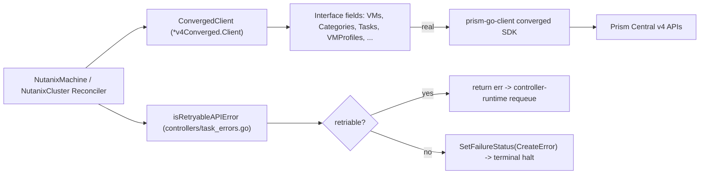
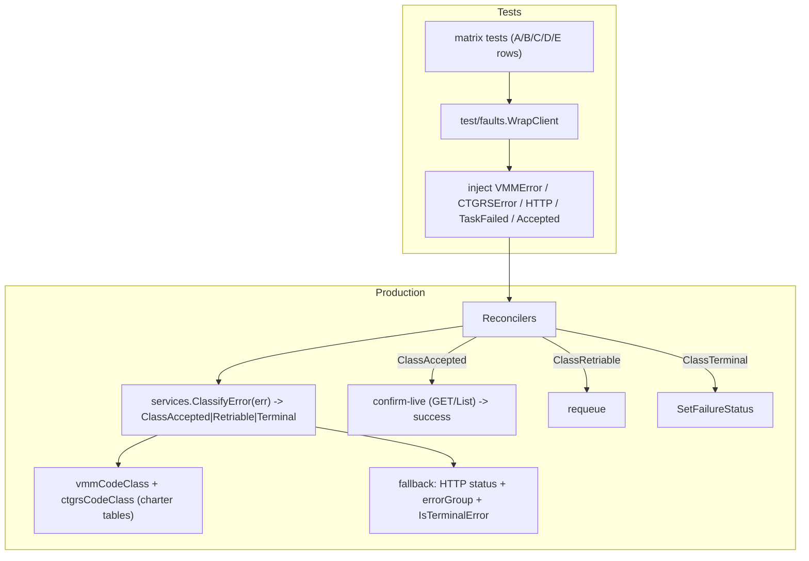
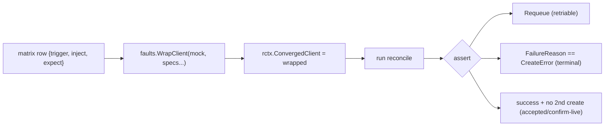

# CAPX Error Injection & Classification — HLD / LLD

Status: Draft (design only)
Scope: `cluster-api-provider-nutanix`, branch `issur/refactor`
Driver: "CAPX Enterprise Readiness - Charter.pdf" (Categories / `CTGRS-*`) and "CAPX Enterprise Readiness - Charter-2.pdf" (VMM / `VMM-*`)

---

## 1. Problem statement

The two Enterprise-Readiness charters define, for the Categories and VMM Prism Central (PC) services:

1. A full **error-code taxonomy** classified into three buckets: **Accepted** (treat as success), **Retriable**, and **Terminal**.
2. An **API test matrix** (`A/B/C/D/E` rows) that, for each trigger, states the expected PC response and the expected CAPX behavior, and flags where "CAPX today" diverges (`gap`).

CAPX today classifies errors only by HTTP status + SDK `errorGroup` (`isRetryableAPIError`), not by the specific `VMM-xxxxx` / `CTGRS-xxxxx` numeric codes. There is also no mechanism to deterministically inject these errors to validate controller behavior against the matrix.

Two deliverables:

- **D1 - Classification:** make CAPX classify PC errors by charter code and act correctly (retry vs terminal vs accepted-as-success), closing the flagged gaps.
- **D2 - Injection:** a reusable fault-injection harness to drive every matrix row in unit tests, plus an optional e2e fault proxy.

---

## 2. High-Level Design (HLD)

### 2.1 Where errors flow today



Key facts (current `issur/refactor` layout):

- Every PC resource is an **interface field** of `*v4Converged.Client`. That boundary is the single injection seam.
- `isRetryableAPIError` lives in [controllers/task_errors.go](controllers/task_errors.go) and only understands `converged.IsNotFound / IsRateLimit / IsInternal` + "any parsed `*converged.APIError` => terminal".
- Deterministic config errors use `services.NewTerminalError` / `services.IsTerminalError` ([pkg/services/errors.go](pkg/services/errors.go)).
- Terminal failures are stamped by `MachineContext.SetFailureStatus(createErrorFailureReason, ...)` ([pkg/context/context.go](pkg/context/context.go) L147), which permanently halts reconciliation.
- Async task failures are enriched with failed-subtask messages in [controllers/task_errors.go](controllers/task_errors.go) (`waitForConvergedOperation` L40, `enrichTaskErrorWithFailedSubtasks` L51).
- **PR #818 (`fcb5e319`) already recovers from sticky failed VM creates:** `isPrismTaskFailed` detects a confirmed task failure, `recoverStickyFailedVMCreate` arms a durable 30m backoff and mints a fresh idempotency key, `adoptVMAfterFailedCreate` re-reads and adopts a VM created by the failed task, and after 4 confirmed failures it stamps `SetFailureStatus`. It intentionally does **not** classify Prism task error text ("not enough cores", quota, invalid config all look alike). This design adds that classification on top: terminal codes short-circuit the 4-attempt budget, accepted codes adopt, retriable/unknown keep the backoff.

### 2.2 Target architecture

Introduce a **charter-code classifier** in `pkg/services` and route all "is this retriable / terminal / accepted" decisions through it. Add a **fault-injection decorator** over the converged client used only by tests.



### 2.3 Design principles

- **Single source of truth.** One classifier (`services.ClassifyError`) consumed by controllers and `pkg/services`. No per-call-site code lists.
- **Charter-as-data.** The `VMM-*` / `CTGRS-*` tables are plain maps so the matrix test can assert table completeness against the charters.
- **Backward compatible fallback.** If a code is absent from the table, behavior falls back to today's HTTP-status/errorGroup logic, so unknown codes never regress.
- **Zero production dependency on test code.** Injection lives under `test/faults`; production never imports it.
- **No new API surface unless required.** Only add a condition/reason constant if a gap (NCN-101935 warning) needs one.

### 2.4 Behavior changes (gap closure, from the charters)

- **Accepted-as-success (Charter A2/C2; VMM A1/A2 "confirm-live").** Extends the pattern commit `2419ac1a` already applied to "category already exists". On an Accepted code during create, skip failure and proceed to GET/List confirm-live.
- **VMM `D6` gap.** `RETRYABLE_ERROR` (`VMM-10011/10012`) on create is currently treated terminal; the table reclassifies it retriable -> requeue.
- **VMM `D2/D3/D5/E2` gaps (task FAILED).** Classify the enriched task error by code: terminal shortage/placement errors stamp failure; retriable subtask failures requeue; a replayed failed Request-Id (`E2`) is guarded against an infinite loop.
- **Charter `D2` / NCN-101935.** Replace the silent swallow of "category still has entities" on delete with an accepted-non-fatal classification + a Warning event, then continue the delete ordering (`VM -> RP -> PP -> Categories`).

---

## 3. Low-Level Design (LLD)

### 3.1 New file: `pkg/services/error_classification.go`

```go
package services

type ErrorClass int

const (
    ClassUnknown ErrorClass = iota
    ClassAccepted            // desired state already satisfied -> treat as success
    ClassRetriable           // transient -> requeue
    ClassTerminal            // deterministic -> SetFailureStatus
)

// Charter tables, keyed by full code string.
var vmmCodeClass = map[string]ErrorClass{
    // Retriable (Charter-2 §1): API_NOT_ENABLED, ETAG_MISMATCH, OPERATION_TIME_OUT,
    // RETRYABLE_ERROR, VM_SERVICE_UNAVAILABLE, VM_STORAGE_CLUSTER_NOT_REACHABLE, ...
    "VMM-10005": ClassRetriable, "VMM-10003": ClassRetriable,
    "VMM-10011": ClassRetriable, "VMM-10012": ClassRetriable, // D6 fix
    "VMM-10002": ClassRetriable, "VMM-36001": ClassRetriable,
    // Accepted (Charter-2 §2): ALREADY_EXISTS, VM_ALREADY_EXISTS, *_NOT_MODIFIED, ...
    "VMM-30101": ClassAccepted, "VMM-30611": ClassAccepted, "VMM-30616": ClassAccepted,
    // Terminal (Charter-2 §3): INTERNAL_ERROR(10000), INVALID_ARGUMENT, *_NOT_FOUND,
    // RESOURCE_SHORTAGE, NO_SCHEDULABLE_HOST, UNAUTHORIZED, ...
    "VMM-10000": ClassTerminal, "VMM-30106": ClassTerminal, "VMM-30604": ClassTerminal,
    "VMM-31201": ClassTerminal, "VMM-34418": ClassTerminal, /* ...full set... */
}

var ctgrsCodeClass = map[string]ErrorClass{
    // Accepted (Charter §Accepted): 50002, 50023, 50044
    "CTGRS-50002": ClassAccepted, "CTGRS-50023": ClassAccepted, "CTGRS-50044": ClassAccepted,
    // Retriable: 50004, 50010, 50011, 50012, 50020, 50022, 50024, 50035, 50037, 50051
    "CTGRS-50004": ClassRetriable, "CTGRS-50022": ClassRetriable, "CTGRS-50037": ClassRetriable,
    // Terminal: 50001, 50005, 50006, 50008(NCN-101935 -> handled as accepted-non-fatal on delete), ...
    "CTGRS-50001": ClassTerminal, "CTGRS-50005": ClassTerminal, /* ...full set... */
}
```

Classifier and predicates:

```go
// ClassifyError maps an error to its charter class, with safe fallback.
func ClassifyError(err error) ErrorClass {
    if err == nil {
        return ClassUnknown
    }
    if IsTerminalError(err) {              // deterministic config error
        return ClassTerminal
    }
    if code, ok := extractCode(err); ok {  // "VMM-xxxxx" / "CTGRS-xxxxx"
        if c, ok := vmmCodeClass[code]; ok {
            return c
        }
        if c, ok := ctgrsCodeClass[code]; ok {
            return c
        }
    }
    // Fallback to today's semantics.
    switch {
    case converged.IsNotFound(err):
        return ClassTerminal
    case converged.IsRateLimit(err), converged.IsInternal(err):
        return ClassRetriable
    default:
        var apiErr *converged.APIError
        if errors.As(err, &apiErr) {
            return ClassTerminal // parsed 4xx
        }
        return ClassRetriable    // transport/network
    }
}

func IsAcceptedError(err error) bool  { return ClassifyError(err) == ClassAccepted }
func IsRetriableError(err error) bool { return ClassifyError(err) == ClassRetriable }

// Operation-aware refinement; see §3.3b for the full case list.
func ClassifyErrorForOp(err error, op Op) ErrorClass
func IsAcceptedOnDelete(err error) bool // == ClassifyErrorForOp(err, OpDelete) == ClassAccepted

// extractCode pulls a VMM-/CTGRS- code from the converged.APIError message/body.
// Confirmed against converged/v4/errors.go during implementation; regex fallback
// on APIError.Message if the SDK does not surface the numeric code directly.
var codeRE = regexp.MustCompile(`\b((?:VMM|CTGRS)-\d{4,5})\b`)
func extractCode(err error) (string, bool) { /* unwrap APIError, scan body+message */ }
```

### 3.2 Refactor: `controllers/task_errors.go`

Delegate the existing predicate (no call-site churn, since `isRetryableAPIError` stays the controller-local name):

```go
// controllers/task_errors.go (L184)
func isRetryableAPIError(err error) bool {
    return services.ClassifyError(err) == services.ClassRetriable
}
```

### 3.3 Wiring changes (controllers)

| Gap | Location | Change |
| --- | --- | --- |
| Accepted on VM create | `createAndWaitForVM` [controllers/nutanixmachine_controller.go](controllers/nutanixmachine_controller.go) L2206, `vmCreateFailure` L2224 | In `vmCreateFailure`, if `services.IsAcceptedError(err)` return a sentinel so the caller does a GET/List confirm-live instead of failing. |
| Accepted on profile deploy | `deployVMFromProfile` L2233 (L2256-2272) | Same accepted-as-success handling around `DeployVmWithVmProfile` / `vmOp.Wait`. |
| Accepted on category create | `getOrCreateCategoryForProject` [controllers/helpers.go](controllers/helpers.go) L810 | Build on `2419ac1a`: on Accepted codes, resolve the existing extId (reuse `existingCategoryExtID`) and return success. |
| D6 retriable-on-create | `vmCreateFailure` L2224 | Already correct once table reclassifies `VMM-10011/10012` -> `ClassRetriable`. |
| Task-FAILED D2/D3/D5 (layered on #818) | `recoverStickyFailedVMCreate` [controllers/nutanixmachine_controller.go](controllers/nutanixmachine_controller.go) | #818 already detects failure (`isPrismTaskFailed`) and runs a blind 4-attempt backoff. Refine it with `services.ClassifyErrorForOp(err, OpCreate)`: **Terminal** codes short-circuit the budget -> immediate `SetFailureStatus` (no 30m waits); **Accepted** codes adopt (`adoptVMAfterFailedCreate` already does the re-read); **Retriable/unknown** keep the existing backoff. E2 replay-loop already fixed by #818. |
| NCN-101935 | `deleteCategoryKeyValuesForProject` [controllers/helpers.go](controllers/helpers.go) L765-772 | Replace `return nil` swallow: if `services.IsAcceptedError(err)` (CTGRS-50008 etc.), log + emit Warning event (new reason) and `continue`; otherwise return the error. |

`SetFailureStatus(createErrorFailureReason, ...)` remains the terminal mechanism; the only change is the predicate feeding the `if !isRetryableAPIError(err)` guards (36 call sites in [controllers/nutanixmachine_controller.go](controllers/nutanixmachine_controller.go)).

### 3.3b Operation-dependent error semantics (context matters)

A code's charter class is **not** sufficient on its own: the same code can mean "fail" for one operation and "already done / success" for another. The charter even encodes this (Category `D1/D3`: 404-on-delete is the *ideal* behaviour; VMM table: `VM_NOT_FOUND` is terminal for read/create). So `ClassifyError` must be composed with the **operation and lifecycle phase** at the call site. The following cases were found in the codebase and are all handled by the design.

Legend: Accept = treat as success/continue; Terminal = `SetFailureStatus`; Retry = requeue.

- **1. 404 / not-found on VM delete (two points).**
  - GET point: `FindVMByUUID` ([controllers/helpers.go](controllers/helpers.go) L181-188) already returns `nil,nil` on `converged.IsNotFound`, so `reconcileDelete` removes finalizers ([controllers/nutanixmachine_controller.go](controllers/nutanixmachine_controller.go) L382-387). Correct; charter Category-`D3` analogue. Keep as-is.
  - DELETE race point: `DeleteVM` -> `VMs.DeleteAsync` ([controllers/helpers.go](controllers/helpers.go) L167-171) can 404 if the VM vanished between GET and DELETE; today it is marked `DeletionFailed` and requeued (gap). Fix: `services.IsAcceptedOnDelete(err)` at L457 -> remove finalizers, `Result{}, nil`.
  - Decision: `VMM-30100` / HTTP 404 => Terminal for create/read, **Accept** for delete.

- **2. `VM_ALREADY_EXISTS` (`VMM-30101`) on create = adoption, not failure.** Create path first does `FindVM`; if the VM exists it adopts it via `markVMProvisioned` and returns ([controllers/nutanixmachine_controller.go](controllers/nutanixmachine_controller.go) L2004-2014). But a replayed Request-Id can make `CreateAsync` itself return `VMM-30101`. Decision: **Accept** on create -> confirm-live GET by name/Request-Id and adopt; never stamp failure. (Charter VMM `A2`/`E1`.) The existing comment at `nutanixmachine_controller_test.go` L3700-3702 captures the "must not leak an existing VM" intent.

- **3. Category "already exists" (`CTGRS-50002/50023/50044`) on create.** Already handled (commit `2419ac1a`, `existingCategoryExtID` [controllers/helpers.go](controllers/helpers.go) L884-891): parse extId from the message and adopt. Decision: **Accept** on create; the design only formalizes it in the table.

- **4. Category "still has entities" (NCN-101935, `CTGRS-50008` and the policy/VG family 50009/50017/50018/50036/50039/50040/50042) on delete.** These are *terminal* in the raw taxonomy (a hard 400), but on the **delete** path they mean "external user entities still reference this category" and must not block cluster teardown. Current code silently `return nil` ([controllers/helpers.go](controllers/helpers.go) L765-772). Decision: **Accept-with-Warning** on delete -> emit a Warning event/condition (new reason, e.g. `CategoryInUseWarning`) and continue; **Terminal** everywhere else.

- **5. Protection Policy / Recovery Plan not-found on delete (DR path).** `deleteVHADomainProtectionPolicy` already guards `if !converged.IsNotFound(err)` ([controllers/nutanixvirtualhadomain_controller.go](controllers/nutanixvirtualhadomain_controller.go) L1012-1017), and recovery-plan/PP delete in the metro decoupling path behaves similarly. Decision: not-found on delete => **Accept**. The design extends `IsAcceptedOnDelete` to cover these so the behavior is uniform rather than ad-hoc per call site.

- **6. ETag / If-Match mismatch (`VMM-*_ETAG_MISMATCH` 30303/32805/34023/..., HTTP 412) on update.** Charter: the *same* If-Match keeps failing (terminal), but a **fresh read + retry** is a new request that can succeed (retriable). Decision: on update, classify as **Retry-after-reread** (requeue so the next reconcile re-GETs and re-sends), not a terminal stamp. CAPX does few updates today, but the rule is encoded so update paths (e.g. project assignment, categories on VM) behave correctly.

- **7. Not-found during create-time dependency resolution (subnet/image/PE/project/GPU).** `pkg/services/*` return `services.NewTerminalError` for these ([pkg/services/subnet.go](pkg/services/subnet.go) L112, [pkg/services/image.go](pkg/services/image.go) L85, [pkg/services/cluster_resources.go](pkg/services/cluster_resources.go) L63, GPU). Decision: not-found of a **referenced dependency** during create => **Terminal** (user misconfiguration), which is the opposite of case 1. This is why the not-found class is operation-scoped, not global.

To support this without scattering logic, the classifier takes an operation hint:

```go
type Op int
const ( OpUnknown Op = iota; OpCreate; OpRead; OpUpdate; OpDelete )

// ClassifyErrorForOp refines ClassifyError with operation context.
//   - not-found: Accept on OpDelete, Terminal otherwise
//   - already-exists: Accept on OpCreate, else table default
//   - etag-mismatch: Retriable on OpUpdate (re-read), else table default
//   - category-in-use (NCN-101935 family): Accept-with-Warning on OpDelete, else Terminal
func ClassifyErrorForOp(err error, op Op) ErrorClass

func IsAcceptedOnDelete(err error) bool // == ClassifyErrorForOp(err, OpDelete) == ClassAccepted
```

`ClassifyError(err)` stays as the op-agnostic default (used by `isRetryableAPIError`); call sites that are inherently delete/update/create pass the matching `Op`. These seven cases become explicit matrix rows (see §3.5): VMM delete-404, VMM `A2`/`E1` already-exists, Category `D2`/`D3`, DR PP/RP delete-404, ETag-on-update, and create-time dependency-not-found.

### 3.4 New package: `test/faults/`

```go
package faults

// Spec programs one fault on a named operation.
type Spec struct {
    Op        string               // "VMs.CreateAsync", "Categories.Delete", "Tasks.Wait", ...
    Match     func(args ...any) bool // optional arg predicate
    FailTimes int                  // N failures, then pass (retry/confirm-live rows); 0 = always
    Err       error                // what to return
}

// Error builders shape *converged.APIError / SDK GenericOpenAPIError bodies so that
// both services.ClassifyError and the SDK's Categorise observe the right code+status.
func VMMError(code string, httpStatus int) error
func CTGRSError(code string, httpStatus int) error
func HTTP(status int) error                 // 429/500/502/503/504 etc.
func TaskFailed(subtaskMsg string) error     // drives enrichTaskErrorWithFailedSubtasks
func Accepted(code string) error

// WrapClient returns a *v4Converged.Client whose interface fields are decorators
// that apply specs before delegating. Reuses the NewMockConvergedClient assembly.
func WrapClient(real *v4Converged.Client, specs ...Spec) *v4Converged.Client
```

The decorator is a thin struct per interface (`VMs`, `Categories`, `Tasks`, `VMProfiles`, `VolumeGroups`) that consults matching specs, decrements `FailTimes`, and otherwise calls through. `Operation[T]` returned by async ops is wrapped so `Wait` can fail on command (A4 "crash before response", D-series task FAILED).

### 3.5 Matrix test suites



- `controllers/vmm_error_matrix_test.go` — `A1-A4, B1-B4, C1-C8, D1-D8, E1-E2`.
- `controllers/category_error_matrix_test.go` — `A1-A5, B1-B7, C1-C3, D1-D3`.
- `pkg/services/error_classification_test.go` — asserts every charter code maps to its stated class (table completeness), plus the operation-dependent cases from §3.3b: delete-404 (VM, PP, RP), already-exists-on-create (VM + category), category-in-use-on-delete, etag-mismatch-on-update, and dependency-not-found-on-create (terminal).

### 3.6 Optional e2e fault proxy (stretch)

A `http.RoundTripper` inserted into the v4 client transport in [test/e2e/nutanix_client.go](test/e2e/nutanix_client.go) that rewrites selected responses to charter codes/statuses, gated by a `FAULT_INJECTION` label so default e2e runs are unaffected. Per [AGENTS.md](AGENTS.md), unit + matrix tests are primary; e2e is opt-in only.

---

## 4. Testing & validation

- Unit: `make unit-test` (regenerates mocks). Matrix suites above provide row-by-row coverage.
- Static: `make fmt && make vet && make lint`.
- `make generate` / `make manifests` only if a new condition/reason constant is added for the NCN-101935 Warning in [api/v1beta1/conditions.go](api/v1beta1/conditions.go).
- Not running e2e unless explicitly requested.

---

## 5. Risks & assumptions

- **Code extraction shape.** Depends on whether the converged SDK surfaces the numeric code in `APIError`. Mitigation: regex fallback over `APIError.Message` + `errorGroup`.
- **Large terminal tables.** `MIGRATE_VM_ERROR` (207 codes) etc. are included for completeness though CAPX never drives migrate; no matrix rows exercise them.
- **Accepted-as-success safety.** Only codes the charter explicitly marks Accepted are treated as success, always followed by a confirm-live GET/List so CAPX never assumes an object exists without verifying.
- **No behavior change on unknown codes** due to the HTTP-status fallback.

---

## 6. Work breakdown

1. `pkg/services/error_classification.go` — tables + `ClassifyError` + predicates; delegate `isRetryableAPIError`.
2. Wire gaps (§3.3) into controllers + `task_errors.go`; NCN-101935 Warning.
3. `test/faults/` harness.
4. Matrix + classification tests.
5. Validate (`fmt/vet/lint/unit-test`); optional e2e proxy.
